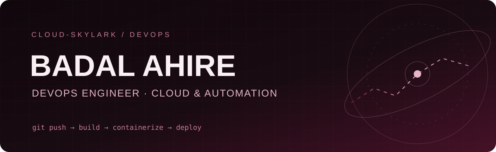

**Building reliable deployments, one pipeline at a time.**

[GitHub](https://github.com/Cloud-Skylark) · [LinkedIn](https://www.linkedin.com/in/badal-ahire-45977b294) · [Email](mailto:badalahire19@gmail.com)

## About me

I'm **Badal Ahire (Cloudy)**, an aspiring **DevOps Engineer** based in Pune, India. I build hands-on projects around CI/CD, containerization, Kubernetes deployments, AWS, and Python automation. My background in Spring Boot and Android development helps me understand the applications behind the infrastructure.

- 🔧 Working with **Jenkins, Docker, Kubernetes, Linux, Git and AWS**
- 🐍 Building automation with **Python and boto3**
- 📈 Exploring **Prometheus and Grafana** for monitoring
- 🎯 Open to **Junior / Associate DevOps Engineer** opportunities

## Selected projects

### [3-Tier Task Manager — Kubernetes & Jenkins](https://github.com/Cloud-Skylark/Task-Manager-frontend)

A full-stack application with an HTML/CSS/JavaScript frontend, Spring Boot API, and PostgreSQL database. Containerized the application with Docker, deployed workloads using Kubernetes Deployments and Services, and configured Jenkins to automate image build, push, and deployment. Used PV/PVC storage for PostgreSQL and investigated deployment and networking issues during setup.

**Stack:** Jenkins · Docker · Kubernetes · Spring Boot · PostgreSQL · GitHub

### [CloudVault — Python AWS S3 Backup Automation](https://github.com/Cloud-Skylark/Python-Automation-with-AWS-S3)

Python-based backup utility for creating timestamped ZIP archives and optionally uploading them to Amazon S3 with boto3. Includes progress feedback and bucket selection/creation workflows.

**Stack:** Python · boto3 · Amazon S3 · ZIP automation

## Toolkit

| Area | Technologies |
| :-- | :-- |
| **CI/CD & Source Control** | Jenkins, Git, GitHub |
| **Containers & Orchestration** | Docker, Kubernetes, Helm (learning) |
| **Cloud** | AWS (EC2, S3, IAM, VPC, RDS, CloudWatch) |
| **Scripting & OS** | Python, boto3, Linux (Ubuntu) |
| **Monitoring** | Prometheus, Grafana (learning) |
| **Application & Data** | Spring Boot, PostgreSQL, HTML/CSS/JavaScript, Android |

## GitHub activity

My real public contribution activity is available on [my GitHub profile](https://github.com/Cloud-Skylark#user-activity-overview). No generated or estimated contribution counts are shown here.

## Education

**Bachelor of Computer Applications (BCA)** — S.V.K.T. College, Deolali Camp, Nashik · Savitribai Phule Pune University · 2025

