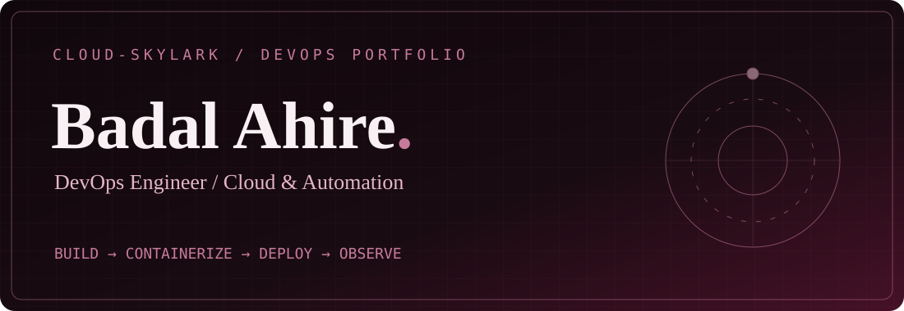
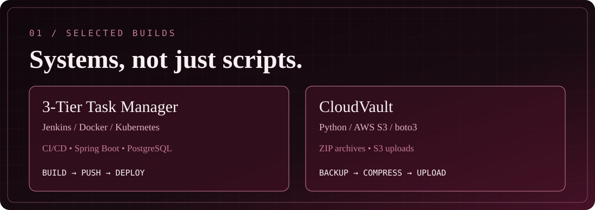
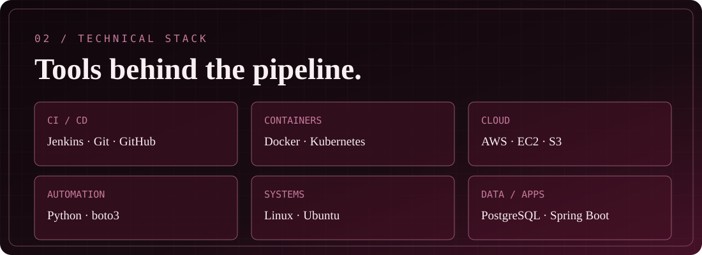

**Junior / Associate DevOps Engineer · Pune, India**

[GitHub](https://github.com/Cloud-Skylark) &nbsp;·&nbsp; [LinkedIn](https://linkedin.com/in/badalahire) &nbsp;·&nbsp; [Email](mailto:badalahire19@gmail.com)

### The person behind the pipeline

I'm **Badal Ahire (Cloudy)**, an entry-level DevOps engineer who enjoys turning application code into repeatable deployments. I work hands-on with **Jenkins, Docker, Kubernetes, Linux, AWS and Python automation**. My Spring Boot and Android background helps me understand the software I'm deploying—not just the infrastructure around it.

Currently exploring **Prometheus and Grafana**. Open to junior and associate DevOps opportunities.

| Project | What I built | Source |
| :--- | :--- | :--- |
| **3-Tier Task Manager** | Spring Boot API, web frontend and PostgreSQL; Docker containers, Kubernetes Deployments/Services, persistent storage and a Jenkins **build → push → deploy** pipeline. No automated test stage claimed. | [Explore repository](https://github.com/Cloud-Skylark/Task-Manager-frontend) |
| **CloudVault** | Python backup utility with timestamped ZIP archives and optional S3 upload via boto3. | [Explore repository](https://github.com/Cloud-Skylark/Python-Automation-with-AWS-S3) |

### Activity / contribution record

My actual public GitHub contribution calendar is visible on [my GitHub profile](https://github.com/Cloud-Skylark). This README intentionally avoids fabricated streaks, rankings, and contribution totals.

### Background

**Bachelor of Computer Applications (BCA)** · S.V.K.T. College, Deolali Camp, Nashik · Savitribai Phule Pune University · 2025.

*Build with intention. Deploy with confidence.*

